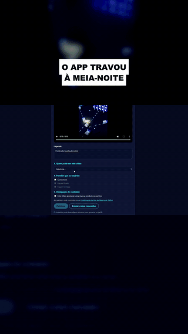
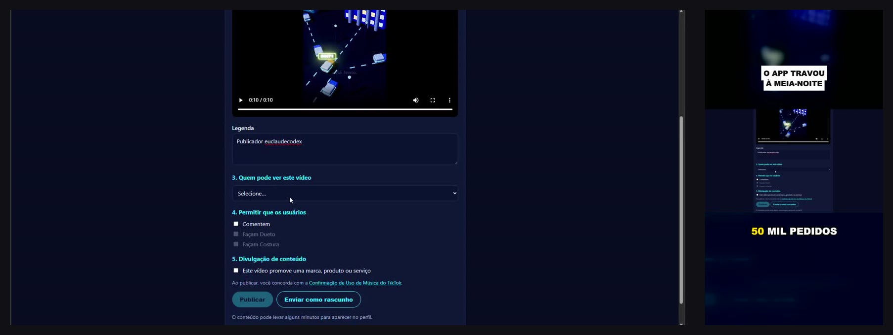
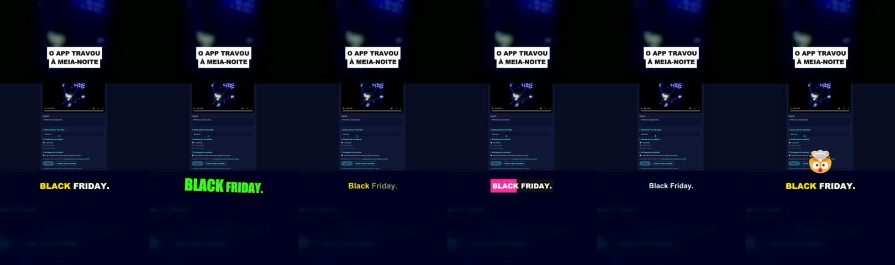
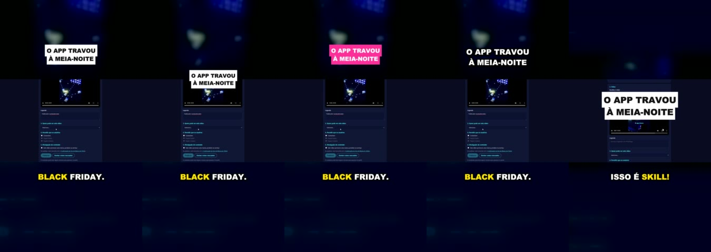

# long-to-shorts ✂️

**Turn any long video into ready-to-post vertical shorts, just by talking to Claude.**

Drop a stream recording, podcast, gameplay or class, say **"clip this"**, and Claude:

1. **watches the whole video** and scores every moment (shouts, laughs, reactions, scene changes);
2. **shows you the list** of the best moments with a proposed hook title, so you can approve, swap or ask for more;
3. renders each clip in **1080×1920** with a hook title, **word-by-word captions**, an impact zoom on the peak and normalized audio;
4. writes the **post caption and hashtags** for each clip.

No editor, no subscription, no watermark. Everything runs on your computer.

🇧🇷 [Leia em português](README.pt-BR.md)

<p align="center">
  
</p>



## Install

You need [Claude](https://claude.ai) on a computer (Windows, macOS or Linux). On first use the skill sets up its own
environment with [uv](https://docs.astral.sh/uv/) (Python, libraries and the speech-to-text model, about 3 GB). Claude
asks before installing uv.

**Claude Code** (terminal, VS Code or the Code tab of the desktop app):

```
/plugin marketplace add euclaudecodex/long-to-shorts-skill
/plugin install long-to-shorts@euclaudecodex
```

**Any agent that supports skills (Claude Code, Codex, Cursor…):**

```
npx skills add euclaudecodex/long-to-shorts-skill
```

**Claude desktop app:** download `long-to-shorts-plugin.zip` from the [latest release](https://github.com/euclaudecodex/long-to-shorts-skill/releases/latest)
and upload it in the app's plugin settings (or upload `long-to-shorts-skill.zip` in the Skills settings).

**Manual:** copy `skills/long-to-shorts` into `~/.claude/skills/` (or run `install.ps1` / `install.sh`).

## Use

```
/shorts D:\Videos\stream.mp4 3 clips @myhandle
```

or just ask:

> clip this stream into 5 shorts: ~/Videos/stream.mp4

> find the most viral moments of this podcast, karaoke captions: C:\Podcast\ep12.mp4

> show me all the caption styles on my video

Clips land in a `cortes/` folder next to the video, each with the MP4, a `.txt` with title + caption + hashtags and a
contact sheet for review.

## Styles

Ask Claude to "show me the styles" and it renders the same frame of **your** video in every style:



| Captions | Look |
|---|---|
| `destaque` | bold caps, the spoken word in yellow (default) |
| `beasty` | thick colorful words that pop |
| `karaoke` | the full line lights up word by word |
| `caixa` | words on black tags, the spoken one in pink |
| `minimal` | clean and quiet, for podcasts and classes |
| `emoji` | highlight + colored emoji on keywords |

| Titles | Layouts |
|---|---|
| `caixa` white box on top · `meio` on the cam/game seam · `faixa` brand color · `contorno` outlined · `relampago` big, first 3 seconds only | `blur` game centered on a blurred background · `split` webcam + game, half and half (cam on top or bottom) · `crop` full screen, for vertical or face-centered videos |



## How it works

The heavy lifting is a single Python script, [`scripts/cortes.py`](skills/long-to-shorts/scripts/cortes.py), run with `uv`:

| Command | What it does |
|---|---|
| `analisar` | audio loudness per second, sudden peaks, keyframe scene changes, reaction words and laughs, transcription with [faster-whisper](https://github.com/SYSTRAN/faster-whisper). Long videos (15+ min) are only transcribed around the peaks, so a 3-hour stream takes minutes. Writes a ranked `momentos.md`, frame strips and a `lista.json` for approval |
| `lote` | renders the approved clips, checks each one and writes the post texts |
| `renderizar` | one clip, or a single frame for previews |
| `previa` | the same frame in every caption and title style |
| `conferir` | duration, resolution, loudness (−14 LUFS) and a 12-frame contact sheet |

Claude is the editor: it reads the transcript and the frames, moves the start to the hook, ends right after the
reaction, writes a true hook title and **waits for your OK before rendering anything**.

## Rights

The skill only works with **video files on your computer**: it does not download from YouTube, Twitch or any link, on
purpose. Clip only what you can use: your own content, content you have permission for, or a clipping program that
pays clippers. Clipping someone else's stream without permission can get your channel strikes and takedowns.

## Made by Eu Claude Codex

3D videos about AI, Claude and system design, every week. If this saved you time, **follow the channel** and leave a ⭐:

[YouTube](https://youtube.com/@euclaudecodex) · [TikTok](https://tiktok.com/@euclaudecodex) · [Instagram](https://instagram.com/euclaudecodex)

## License

[MIT](LICENSE)
