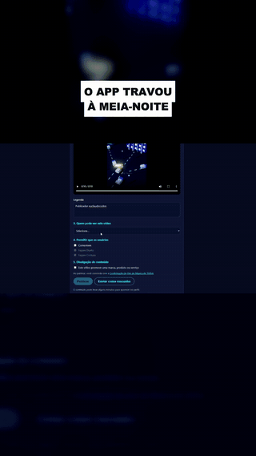
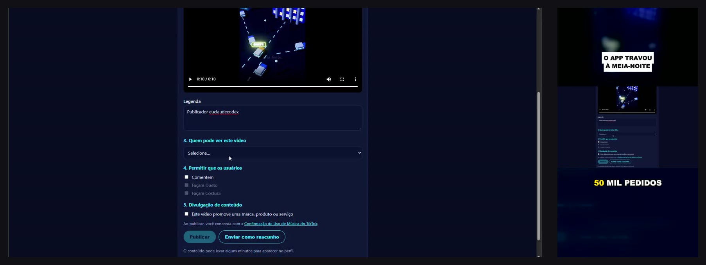
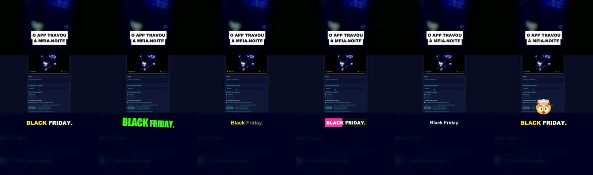
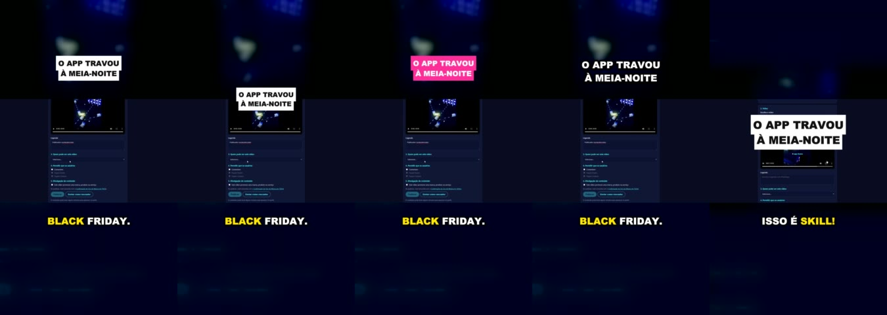

# long-to-shorts ✂️

**Transforme qualquer vídeo longo em cortes verticais prontos para postar, só conversando com o Claude.**

Coloque a gravação da live, o podcast, o gameplay ou a aula, diga **"corta"**, e o Claude:

1. **assiste o vídeo inteiro** e dá nota a cada momento (gritos, risadas, reações, viradas de cena);
2. **mostra a lista** dos melhores momentos com um título-gancho, para você aprovar, trocar ou pedir mais;
3. entrega cada corte em **1080×1920** com título, **legenda palavra a palavra**, zoom de impacto no pico e áudio nivelado;
4. escreve **a legenda do post e as hashtags** de cada corte.

Sem editor, sem mensalidade, sem marca d'água. Tudo roda no seu computador.

🇺🇸 [Read in English](README.md)

<p align="center">
  
</p>



## Instalação

Você precisa do [Claude](https://claude.ai) num computador (Windows, Mac ou Linux). No primeiro uso, a skill prepara o
próprio ambiente com o [uv](https://docs.astral.sh/uv/): Python, bibliotecas e o modelo de transcrição, cerca de 3 GB.
O Claude pede licença antes de instalar o uv.

**Claude Code** (terminal, VS Code ou aba Code do app):

```
/plugin marketplace add euclaudecodex/long-to-shorts-skill
/plugin install long-to-shorts@euclaudecodex
```

**Qualquer agente com skills (Claude Code, Codex, Cursor…):**

```
npx skills add euclaudecodex/long-to-shorts-skill
```

**App do Claude para computador:** baixe o `long-to-shorts-plugin.zip` na [última versão](https://github.com/euclaudecodex/long-to-shorts-skill/releases/latest)
e envie nas configurações de plugins do app (ou envie o `long-to-shorts-skill.zip` nas configurações de Skills).

**Manual:** copie a pasta `skills/long-to-shorts` para `~/.claude/skills/` (ou rode `install.ps1` / `install.sh`).

## Como usar

```
/cortes D:\Videos\live.mp4 3 cortes @meuperfil
```

ou só peça:

> corta essa live em 5 cortes: C:\Videos\live-gta6.mp4

> acha os momentos mais virais desse podcast, legenda estilo karaokê: C:\Podcast\ep12.mp4

> me mostra todos os estilos de legenda no meu vídeo

Os cortes saem numa pasta `cortes/` ao lado do vídeo, cada um com o MP4, um `.txt` com título, legenda do post e
hashtags, e uma folha de conferência.

## Estilos

Peça "me mostra os estilos" e o Claude aplica todos no mesmo quadro do **seu** vídeo:



| Legenda | Como fica |
|---|---|
| `destaque` | caixa alta, a palavra falada em amarelo (padrão) |
| `beasty` | letra grossa e colorida que pula |
| `karaoke` | a frase inteira acende palavra por palavra |
| `caixa` | palavras em tarja preta, a falada em rosa |
| `minimal` | discreta, para podcast e aula |
| `emoji` | destaque + emoji colorido nas palavras-chave |

| Títulos | Enquadramentos |
|---|---|
| `caixa` faixa branca no topo · `meio` na emenda webcam/jogo · `faixa` na cor da marca · `contorno` sem caixa · `relampago` grande, só nos 3 primeiros segundos | `blur` jogo no centro com fundo borrado · `split` webcam e jogo meio a meio (câmera em cima ou embaixo) · `crop` tela cheia, para vídeo vertical ou rosto centralizado |



## Como funciona

O trabalho pesado é um único script Python, [`scripts/cortes.py`](skills/long-to-shorts/scripts/cortes.py), rodado com o `uv`:

| Comando | O que faz |
|---|---|
| `analisar` | volume por segundo, picos repentinos, trocas de cena, falas de reação e risadas, transcrição com o [faster-whisper](https://github.com/SYSTRAN/faster-whisper). Em vídeos de mais de 15 min, transcreve só em volta dos picos: uma live de 3 horas leva minutos. Gera o ranking `momentos.md`, tiras de quadros e o `lista.json` para aprovação |
| `lote` | renderiza os cortes aprovados, confere cada um e escreve os textos dos posts |
| `renderizar` | um corte, ou só um quadro para prévia |
| `previa` | o mesmo quadro em todos os estilos de legenda e de título |
| `conferir` | duração, resolução, volume (−14 LUFS) e folha com 12 quadros |

O Claude é o editor: lê a transcrição e os quadros, move o início para o gancho, termina logo depois da reação, escreve
um título verdadeiro e **espera o seu ok antes de renderizar qualquer coisa**.

## Direitos

A skill trabalha só com **arquivos de vídeo no seu computador**: de propósito, ela não baixa do YouTube, da Twitch nem
de link nenhum. Corte apenas o que você pode usar: o seu conteúdo, conteúdo com autorização ou o de um programa de
cortes que paga cortadores. Cortar live alheia sem autorização pode gerar strike e derrubada no seu canal.

## Feito pelo Eu Claude Codex

Vídeos 3D sobre IA, Claude e system design, toda semana. Se isto te poupou tempo, **segue o canal** e deixa uma ⭐:

[YouTube](https://youtube.com/@euclaudecodex) · [TikTok](https://tiktok.com/@euclaudecodex) · [Instagram](https://instagram.com/euclaudecodex)

## Licença

[MIT](LICENSE)
